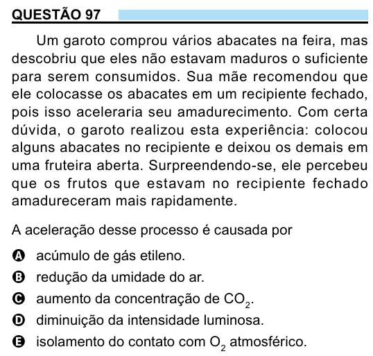

Texto extraído (pode conter ruído)

QUESTÃO 97  
Um garoto comprou vários abacates na feira, mas  
descobriu que eles não estavam maduros o suficiente  
para serem consumidos. Sua mãe recomendou que  
ele colocasse os abacates em um recipiente fechado,  
pois isso aceleraria seu amadurecimento. Com certa  
dúvida, o garoto realizou esta experiência: colocou  
alguns abacates no recipiente e deixou os demais em  
uma fruteira aberta. Surpreendendo-se, ele percebeu  
que os frutos que estavam no recipiente fechado  
amadureceram mais rapidamente.  
A aceleração desse processo é causada por  
A acúmulo de gás etileno.  
B redução da umidade do ar.  
C aumento da concentração de CO 2 .  
D diminuição da intensidade luminosa.  
E isolamento do contato com O 2 atmosférico.

