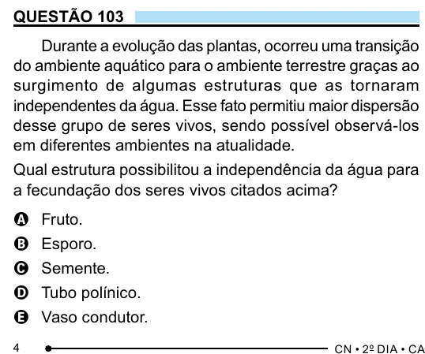

Texto extraído (pode conter ruído)

QUESTÃO 103  
Durante a evolução das plantas, ocorreu uma transição  
do ambiente aquático para o ambiente terrestre graças ao  
surgimento de algumas estruturas que as tornaram  
independentes da água. Esse fato permitiu maior dispersão  
desse grupo de seres vivos, sendo possível observá-los  
em diferentes ambientes na atualidade.  
Qual estrutura possibilitou a independência da água para  
a fecundação dos seres vivos citados acima?  
A Fruto.  
B Esporo.  
C Semente.  
D Tubo polínico.  
E Vaso condutor.  
4

