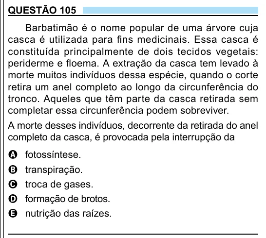

Texto extraído (pode conter ruído)

QUESTÃO 105  
Barbatimão é o nome popular de uma árvore cuja  
casca é utilizada para fins medicinais. Essa casca é  
constituída principalmente de dois tecidos vegetais:  
periderme e floema. A extração da casca tem levado à  
morte muitos indivíduos dessa espécie, quando o corte  
retira um anel completo ao longo da circunferência do  
tronco. Aqueles que têm parte da casca retirada sem  
completar essa circunferência podem sobreviver.  
A morte desses indivíduos, decorrente da retirada do anel  
completo da casca, é provocada pela interrupção da  
fotossíntese.  
A  
transpiração.  
B  
troca de gases.  
C  
formação de brotos.  
D  
E  
nutrição das raízes.

