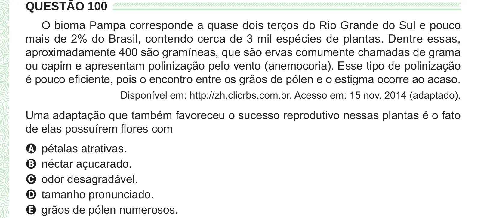

Texto extraído (pode conter ruído)

QUESTÃO 100  
O bioma Pampa corresponde a quase dois terços do Rio Grande do Sul e pouco  
mais de 2% do Brasil, contendo cerca de 3 mil espécies de plantas. Dentre essas,  
aproximadamente 400 são gramíneas, que são ervas comumente chamadas de grama  
ou capim e apresentam polinização pelo vento (anemocoria). Esse tipo de polinização  
é pouco eficiente, pois o encontro entre os grãos de pólen e o estigma ocorre ao acaso.  
Disponível em: http://zh.clicrbs.com.br. Acesso em: 15 nov. 2014 (adaptado).  
Uma adaptação que também favoreceu o sucesso reprodutivo nessas plantas é o fato  
de elas possuírem flores com  
A pétalas atrativas.  
B néctar açucarado.  
C odor desagradável.  
D tamanho pronunciado.  
E grãos de pólen numerosos.

