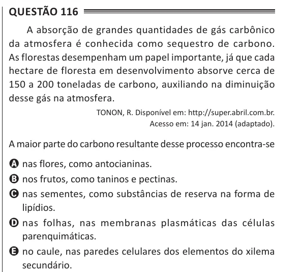

Texto extraído (pode conter ruído)

Questão 116  
A absorção de grandes quantidades de gás carbônico  
da atmosfera é conhecida como sequestro de carbono.  
As florestas desempenham um papel importante, já que cada  
hectare de floresta em desenvolvimento absorve cerca de  
150 a 200 toneladas de carbono, auxiliando na diminuição  
desse gás na atmosfera.  
TONON, R. Disponível em: http://super.abril.com.br.  
Acesso em: 14 jan. 2014 (adaptado).  
A maior parte do carbono resultante desse processo encontra-se  
A nas flores, como antocianinas.  
B nos frutos, como taninos e pectinas.  
C nas sementes, como substâncias de reserva na forma de  
lipídios.  
D nas folhas, nas membranas plasmáticas das células  
parenquimáticas.  
E no caule, nas paredes celulares dos elementos do xilema  
secundário.

