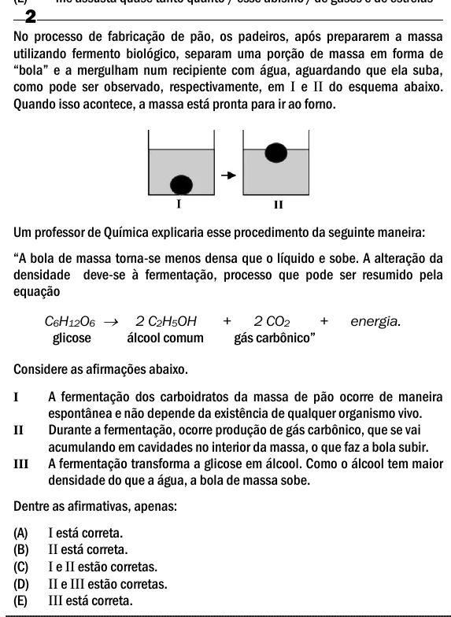

Texto extraído (pode conter ruído)

2  
No processo de fabricação de pão, os padeiros, após prepararem a massa  
utilizando fermento biológico, separam uma porção de massa em forma de  
“bola” e a mergulham num recipiente com água, aguardando que ela suba,  
como pode ser observado, respectivamente, em I e II do esquema abaixo.  
Quando isso acontece, a massa está pronta para ir ao forno.  
Um professor de Química explicaria esse procedimento da seguinte maneira:  
“A bola de massa torna-se menos densa que o líquido e sobe. A alteração da  
densidade deve-se à fermentação, processo que pode ser resumido pela  
equação  
C 6 H 12 O 6  2 C 2 H 5 OH  
+  
2 CO 2  
+  
energia.  
glicose  
álcool comum  
gás carbônico”  
Considere as afirmações abaixo.  
A fermentação dos carboidratos da massa de pão ocorre de maneira  
I  
espontânea e não depende da existência de qualquer organismo vivo.  
Durante a fermentação, ocorre produção de gás carbônico, que se vai  
II  
acumulando em cavidades no interior da massa, o que faz a bola subir.  
A fermentação transforma a glicose em álcool. Como o álcool tem maior  
III  
densidade do que a água, a bola de massa sobe.  
Dentre as afirmativas, apenas:  
(A)  
I está correta.  
(B)  
II está correta.  
(C)  
I e II estão corretas.  
(D)  
II e III estão corretas.  
(E)  
III está correta.

