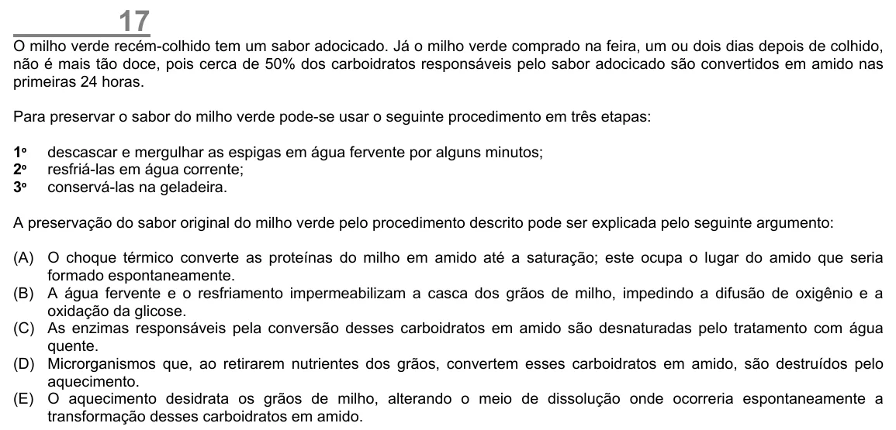

Texto extraído (pode conter ruído)

17  
O milho verde recém-colhido tem um sabor adocicado. Já o milho verde comprado na feira, um ou dois dias depois de colhido,  
não é mais tão doce, pois cerca de 50% dos carboidratos responsáveis pelo sabor adocicado são convertidos em amido nas  
primeiras 24 horas.  
Para preservar o sabor do milho verde pode-se usar o seguinte procedimento em três etapas:  
1 º  
descascar e mergulhar as espigas em água fervente por alguns minutos;  
2 º  
resfriá-las em água corrente;  
3 º  
conservá-las na geladeira.  
A preservação do sabor original do milho verde pelo procedimento descrito pode ser explicada pelo seguinte argumento:  
(A) O choque térmico converte as proteínas do milho em amido até a saturação; este ocupa o lugar do amido que seria  
formado espontaneamente.  
(B) A água fervente e o resfriamento impermeabilizam a casca dos grãos de milho, impedindo a difusão de oxigênio e a  
oxidação da glicose.  
(C) As enzimas responsáveis pela conversão desses carboidratos em amido são desnaturadas pelo tratamento com água  
quente.  
(D) Microrganismos que, ao retirarem nutrientes dos grãos, convertem esses carboidratos em amido, são destruídos pelo  
aquecimento.  
(E) O aquecimento desidrata os grãos de milho, alterando o meio de dissolução onde ocorreria espontaneamente a  
transformação desses carboidratos em amido.

