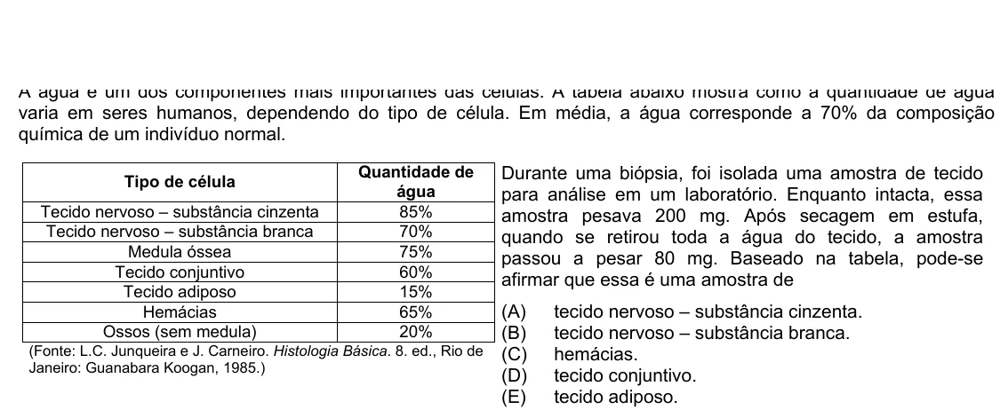

Texto extraído (pode conter ruído)

varia em seres humanos, dependendo do tipo de célula. Em média, a água corresponde a 70% da composição  
química de um indivíduo normal.  
Quantidade de  
Durante uma biópsia, foi isolada uma amostra de tecido  
Tipo de célula  
água  
para análise em um laboratório. Enquanto intacta, essa  
Tecido nervoso – substância cinzenta  
85%  
amostra pesava 200 mg. Após secagem em estufa,  
Tecido nervoso – substância branca  
70%  
quando se retirou toda a água do tecido, a amostra  
Medula óssea  
75%  
passou a pesar 80 mg. Baseado na tabela, pode-se  
Tecido conjuntivo  
60%  
afirmar que essa é uma amostra de  
Tecido adiposo  
15%  
(A)  
tecido nervoso – substância cinzenta.  
Hemácias  
65%  
Ossos (sem medula)  
20%  
(B)  
tecido nervoso – substância branca.  
(Fonte: L.C. Junqueira e J. Carneiro. Histologia Básica. 8. ed., Rio de  
(C)  
hemácias.  
Janeiro: Guanabara Koogan, 1985.)  
(D)  
tecido conjuntivo.  
(E)  
tecido adiposo.

