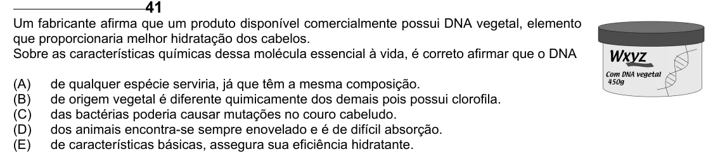

Texto extraído (pode conter ruído)

Um fabricante afirma que um produto disponível comercialmente possui DNA vegetal, elemento  
que proporcionaria melhor hidratação dos cabelos.  
Sobre as características químicas dessa molécula essencial à vida, é correto afirmar que o DNA  
(A)  
de qualquer espécie serviria, já que têm a mesma composição.  
(B)  
de origem vegetal é diferente quimicamente dos demais pois possui clorofila.  
(C)  
das bactérias poderia causar mutações no couro cabeludo.  
(D)  
dos animais encontra-se sempre enovelado e é de difícil absorção.  
(E)  
de características básicas, assegura sua eficiência hidratante.

