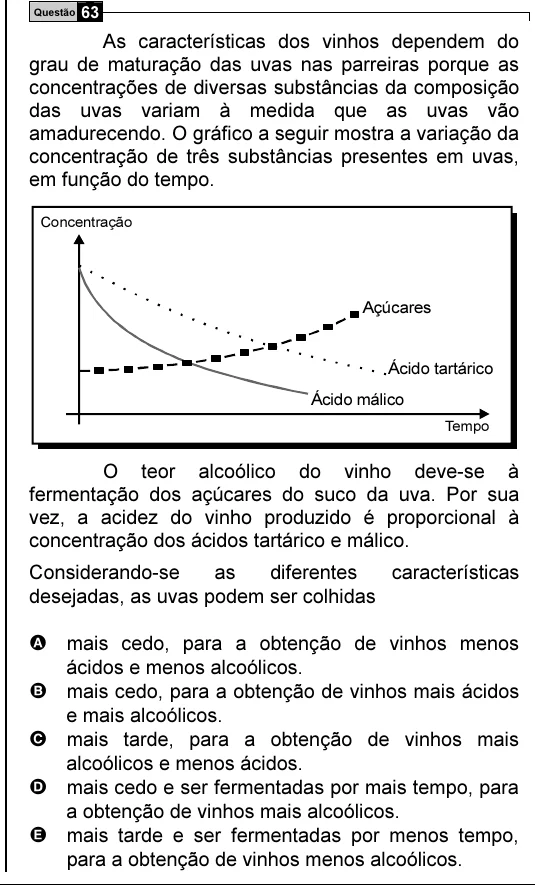

Texto extraído (pode conter ruído)

Questão 63  
As características dos vinhos dependem do  
grau de maturação das uvas nas parreiras porque as  
concentrações de diversas substâncias da composição  
das uvas variam à medida que as uvas vão  
amadurecendo. O gráfico a seguir mostra a variação da  
concentração de três substâncias presentes em uvas,  
em função do tempo.  
Concentração  
Açúcares  
Ácido tartárico  
Ácido málico  
Tempo  
O teor alcoólico do vinho deve-se à  
fermentação dos açúcares do suco da uva. Por sua  
vez, a acidez do vinho produzido é proporcional à  
concentração dos ácidos tartárico e málico.  
Considerando-se  
as  
diferentes  
características  
desejadas, as uvas podem ser colhidas  
A mais cedo, para a obtenção de vinhos menos  
ácidos e menos alcoólicos.  
B mais cedo, para a obtenção de vinhos mais ácidos  
e mais alcoólicos.  
C mais tarde, para a obtenção de vinhos mais  
alcoólicos e menos ácidos.  
D mais cedo e ser fermentadas por mais tempo, para  
a obtenção de vinhos mais alcoólicos.  
E mais tarde e ser fermentadas por menos tempo,  
para a obtenção de vinhos menos alcoólicos.

