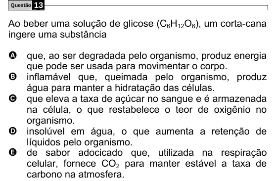

Texto extraído (pode conter ruído)

Questão  
13  
Ao beber uma solução de glicose (C 6 H 12 O 6 ), um corta-cana  
ingere uma substância  
A que, ao ser degradada pelo organismo, produz energia  
que pode ser usada para movimentar o corpo.  
B inflamável que, queimada pelo organismo, produz  
água para manter a hidratação das células.  
C que eleva a taxa de açúcar no sangue e é armazenada  
na célula, o que restabelece o teor de oxigênio no  
organismo.  
D insolúvel em água, o que aumenta a retenção de  
líquidos pelo organismo.  
E de sabor adocicado que, utilizada na respiração  
celular, fornece CO 2 para manter estável a taxa de  
carbono na atmosfera.

