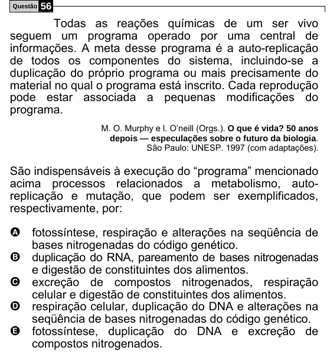

Texto extraído (pode conter ruído)

Questão  
56  
Todas as reações químicas de um ser vivo  
seguem um programa operado por uma central de  
informações. A meta desse programa é a auto-replicação  
de todos os componentes do sistema, incluindo-se a  
duplicação do próprio programa ou mais precisamente do  
material no qual o programa está inscrito. Cada reprodução  
pode estar associada a pequenas modificações do  
programa.  
M. O. Murphy e l. O’neill (Orgs.). O que é vida? 50 anos  
depois — especulações sobre o futuro da biologia.  
São Paulo: UNESP. 1997 (com adaptações).  
São indispensáveis à execução do “programa” mencionado  
acima processos relacionados a metabolismo, auto-  
replicação e mutação, que podem ser exemplificados,  
respectivamente, por:  
A fotossíntese, respiração e alterações na seqüência de  
bases nitrogenadas do código genético.  
B  
duplicação do RNA, pareamento de bases nitrogenadas  
e digestão de constituintes dos alimentos.  
excreção de compostos nitrogenados, respiração  
C  
celular e digestão de constituintes dos alimentos.  
respiração celular, duplicação do DNA e alterações na  
D  
seqüência de bases nitrogenadas do código genético.  
E  
fotossíntese, duplicação do DNA e excreção de  
compostos nitrogenados.

