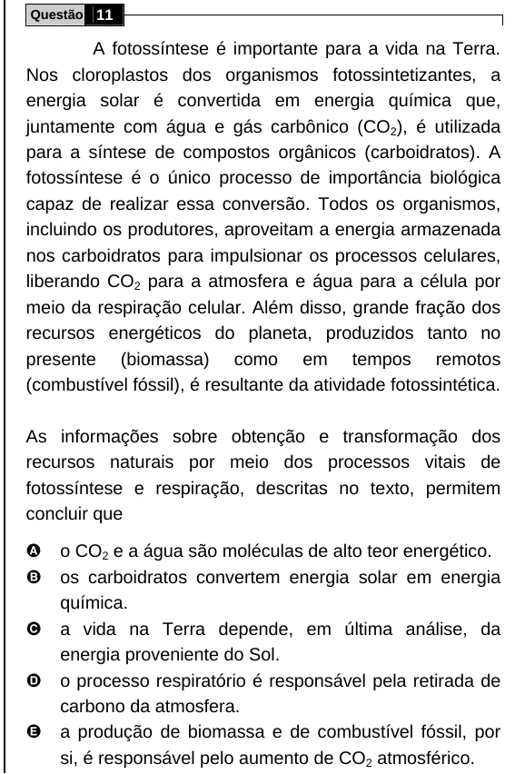

Texto extraído (pode conter ruído)

Questão 11  
A fotossíntese é importante para a vida na Terra.  
Nos cloroplastos dos organismos fotossintetizantes, a  
energia solar é convertida em energia química que,  
juntamente com água e gás carbônico (CO 2 ), é utilizada  
para a síntese de compostos orgânicos (carboidratos). A  
fotossíntese é o único processo de importância biológica  
capaz de realizar essa conversão. Todos os organismos,  
incluindo os produtores, aproveitam a energia armazenada  
nos carboidratos para impulsionar os processos celulares,  
liberando CO 2 para a atmosfera e água para a célula por  
meio da respiração celular. Além disso, grande fração dos  
recursos energéticos do planeta, produzidos tanto no  
presente (biomassa) como em tempos remotos  
(combustível fóssil), é resultante da atividade fotossintética.  
As informações sobre obtenção e transformação dos  
recursos naturais por meio dos processos vitais de  
fotossíntese e respiração, descritas no texto, permitem  
concluir que  
A  
o CO 2 e a água são moléculas de alto teor energético.  
B  
os carboidratos convertem energia solar em energia  
química.  
C  
a vida na Terra depende, em última análise, da  
energia proveniente do Sol.  
D  
o processo respiratório é responsável pela retirada de  
carbono da atmosfera.  
E  
a produção de biomassa e de combustível fóssil, por  
si, é responsável pelo aumento de CO 2 atmosférico.

