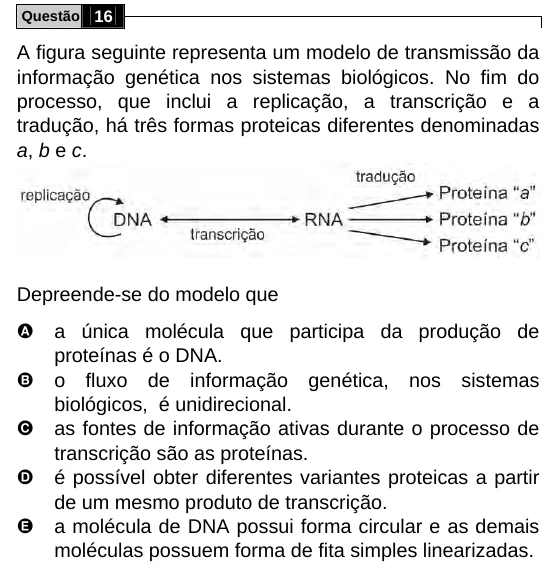

Texto extraído (pode conter ruído)

Questão 16  
A figura seguinte representa um modelo de transmissão da  
informação genética nos sistemas biológicos. No fim do  
processo, que inclui a replicação, a transcrição e a  
tradução, há três formas proteicas diferentes denominadas  
a, b e c.  
Depreende-se do modelo que  
A  
a única molécula que participa da produção de  
proteínas é o DNA.  
B  
o fluxo de informação genética, nos sistemas  
biológicos, é unidirecional.  
C  
as fontes de informação ativas durante o processo de  
transcrição são as proteínas.  
D  
é possível obter diferentes variantes proteicas a partir  
de um mesmo produto de transcrição.  
E  
a molécula de DNA possui forma circular e as demais  
moléculas possuem forma de fita simples linearizadas.

