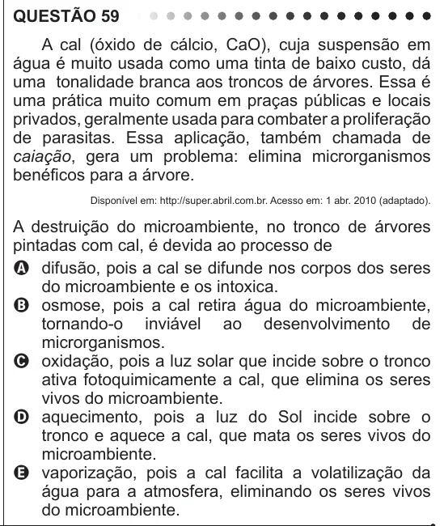

Texto extraído (pode conter ruído)

QUESTÃO 59  
A cal (óxido de cálcio, CaO), cuja suspensão em  
água é muito usada como uma tinta de baixo custo, dá  
uma tonalidade branca aos troncos de árvores. Essa é  
uma prática muito comum em praças públicas e locais  
privados, geralmente usada para combater a proliferação  
de parasitas. Essa aplicação, também chamada de  
caiação, gera um problema: elimina microrganismos  
benéficos para a árvore.  
Disponível em: http://super.abril.com.br. Acesso em: 1 abr. 2010 (adaptado).  
A destruição do microambiente, no tronco de árvores  
pintadas com cal, é devida ao processo de  
A difusão, pois a cal se difunde nos corpos dos seres  
do microambiente e os intoxica.  
B osmose, pois a cal retira água do microambiente,  
tornando-o inviável ao desenvolvimento de  
microrganismos.  
C oxidação, pois a luz solar que incide sobre o tronco  
ativa fotoquimicamente a cal, que elimina os seres  
vivos do microambiente.  
D aquecimento, pois a luz do Sol incide sobre o  
tronco e aquece a cal, que mata os seres vivos do  
microambiente.  
E vaporização, pois a cal facilita a volatilização da  
água para a atmosfera, eliminando os seres vivos  
do microambiente.

