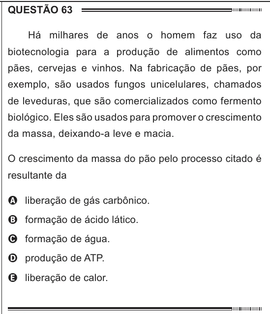

Texto extraído (pode conter ruído)

QUESTÃO 63  
Há milhares de anos o homem faz uso da  
biotecnologia para a produção de alimentos como  
pães, cervejas e vinhos. Na fabricação de pães, por  
exemplo, são usados fungos unicelulares, chamados  
de leveduras, que são comercializados como fermento  
biológico. Eles são usados para promover o crescimento  
da massa, deixando-a leve e macia.  
O crescimento da massa do pão pelo processo citado é  
resultante da  
A liberação de gás carbônico.  
B formação de ácido lático.  
C formação de água.  
D produção de ATP.  
E liberação de calor.

