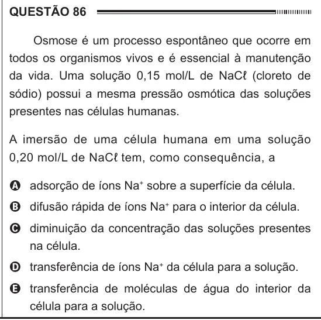

Texto extraído (pode conter ruído)

QUESTÃO 86  
Osmose é um processo espontâneo que ocorre em  
todos os organismos vivos e é essencial à manutenção  
da vida. Uma solução 0,15 mol/L de NaCℓ (cloreto de  
sódio) possui a mesma pressão osmótica das soluções  
presentes nas células humanas.  
A imersão de uma célula humana em uma solução  
0,20 mol/L de NaCℓ tem, como consequência, a  
A adsorção de íons Na + sobre a superfície da célula.  
B difusão rápida de íons Na + para o interior da célula.  
C diminuição da concentração das soluções presentes  
na célula.  
D transferência de íons Na + da célula para a solução.  
E transferência de moléculas de água do interior da  
célula para a solução.

