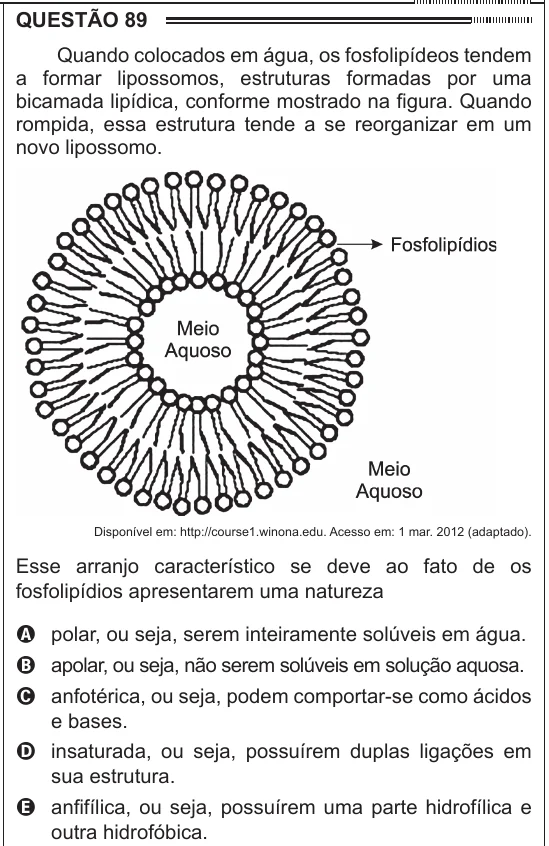

Texto extraído (pode conter ruído)

QUESTÃO 89  
Quando colocados em água, os fosfolipídeos tendem  
a formar lipossomos, estruturas formadas por uma  
bicamada lipídica, conforme mostrado na figura. Quando  
rompida, essa estrutura tende a se reorganizar em um  
novo lipossomo.  
Disponível em: http://course1.winona.edu. Acesso em: 1 mar. 2012 (adaptado).  
Esse arranjo característico se deve ao fato de os  
fosfolipídios apresentarem uma natureza  
A polar, ou seja, serem inteiramente solúveis em água.  
B apolar, ou seja, não serem solúveis em solução aquosa.  
C anfotérica, ou seja, podem comportar-se como ácidos  
e bases.  
D insaturada, ou seja, possuírem duplas ligações em  
sua estrutura.  
E anfifílica, ou seja, possuírem uma parte hidrofílica e  
outra hidrofóbica.

