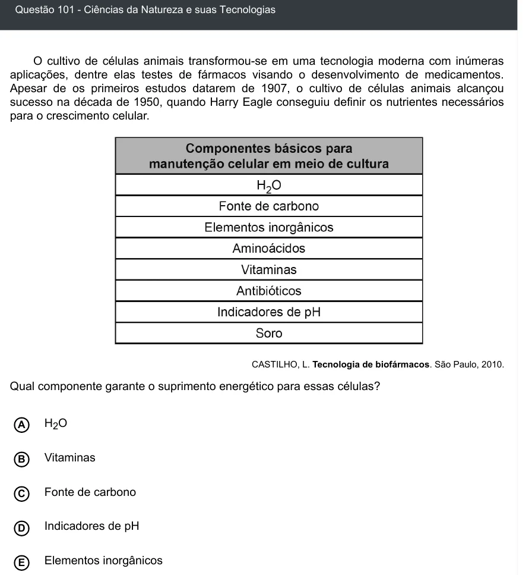

Texto extraído (pode conter ruído)

Questão 101 - Ciências da Natureza e suas Tecnologias  
O cultivo de células animais transformou-se em uma tecnologia moderna com inúmeras  
aplicações, dentre elas testes de fármacos visando o desenvolvimento de medicamentos.  
Apesar de os primeiros estudos datarem de 1907, o cultivo de células animais alcançou  
sucesso na década de 1950, quando Harry Eagle conseguiu definir os nutrientes necessários  
para o crescimento celular.  
CASTILHO, L. Tecnologia de biofármacos. São Paulo, 2010.  
Qual componente garante o suprimento energético para essas células?  
H 2 O  
A  
Vitaminas  
B  
C  
Fonte de carbono  
Indicadores de pH  
D  
Elementos inorgânicos  
E

