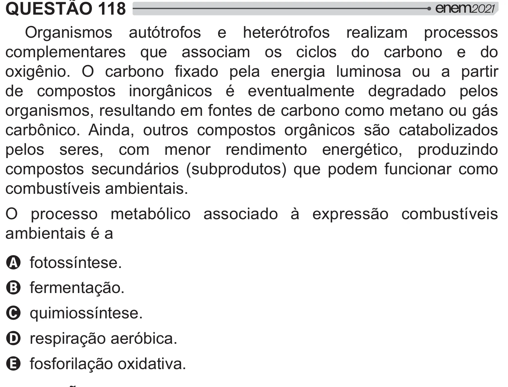

Texto extraído (pode conter ruído)

QUESTÃO 118  
Organismos autótrofos e heterótrofos realizam processos  
complementares que associam os ciclos do carbono e do  
*+!  y * #          #   
de compostos inorgânicos é eventualmente degradado pelos  
organismos, resultando em fontes de carbono como metano ou gás  
y2!     #   ­  [  y   
pelos seres, com menor rendimento energético, produzindo  
compostos secundários (subprodutos) que podem funcionar como  
combustíveis ambientais.  
O processo metabólico associado à expressão combustíveis  
ambientais é a  
A fotossíntese.  
B fermentação.  
C quimiossíntese.  
D respiração aeróbica.  
E fosforilação oxidativa.

