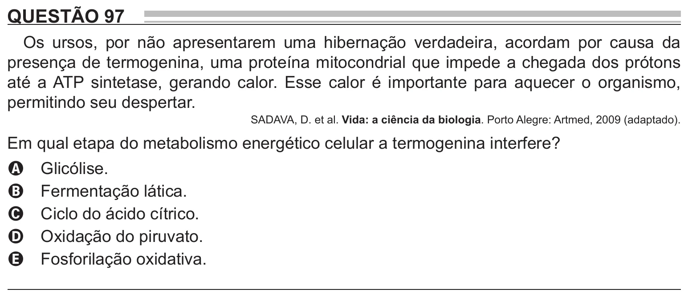

Texto extraído (pode conter ruído)

QUESTÃO 97  
Os ursos, por não apresentarem uma hibernação verdadeira, acordam por causa da  
presença de termogenina, uma proteína mitocondrial que impede a chegada dos prótons  
até a ATP sintetase, gerando calor. Esse calor é importante para aquecer o organismo,  
permitindo seu despertar.  
SADAVA, D. et al. Vida: a ciência da biologia. Porto Alegre: Artmed, 2009 (adaptado).  
Em qual etapa do metabolismo energético celular a termogenina interfere?  
Glicólise.  
A  
Fermentação lática.  
B  
Ciclo do ácido cítrico.  
C  
Oxidação do piruvato.  
D  
Fosforilação oxidativa.  
E

