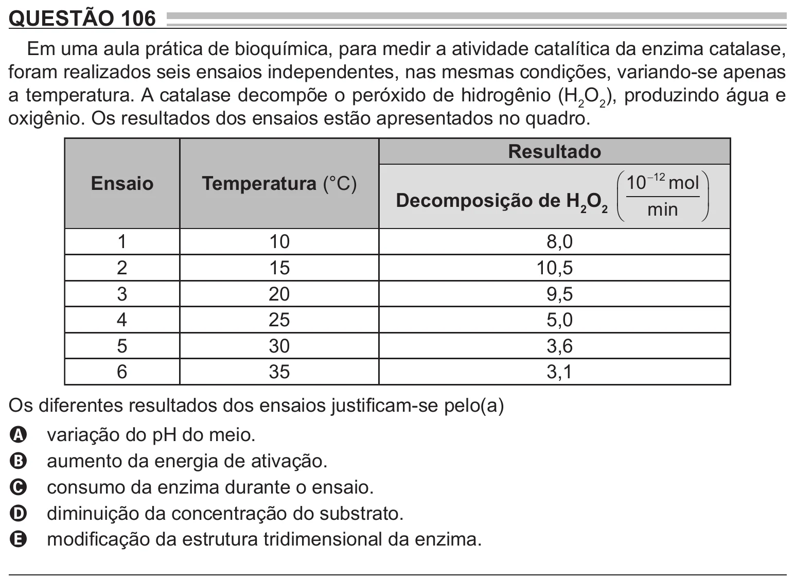

Texto extraído (pode conter ruído)

QUESTÃO 106  
Em uma aula prática de bioquímica, para medir a atividade catalítica da enzima catalase,  
foram realizados seis ensaios independentes, nas mesmas condições, variando-se apenas  
a temperatura. A catalase decompõe o peróxido de hidrogênio (H 2 O 2 ), produzindo água e  
oxigênio. Os resultados dos ensaios estão apresentados no quadro.  
Resultado  
Ensaio  
Temperatura (°C)  
 10  12 mol   
Decomposição de H 2 O 2  min   
  
  
1  
10  
8,0  
2  
15  
10,5  
3  
20  
9,5  
4  
25  
5,0  
5  
30  
3,6  
6  
35  
3,1  
Os diferentes resultados dos ensaios justificam-se pelo(a)  
variação do pH do meio.  
A  
aumento da energia de ativação.  
B  
consumo da enzima durante o ensaio.  
C  
diminuição da concentração do substrato.  
D  
modificação da estrutura tridimensional da enzima.  
E

