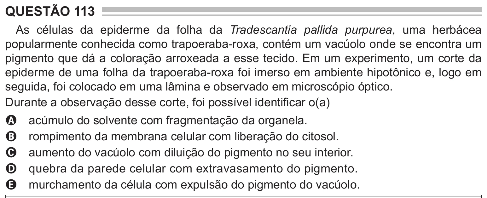

Texto extraído (pode conter ruído)

QUESTÃO 113  
As células da epiderme da folha da Tradescantia pallida purpurea, uma herbácea  
popularmente conhecida como trapoeraba-roxa, contém um vacúolo onde se encontra um  
pigmento que dá a coloração arroxeada a esse tecido. Em um experimento, um corte da  
epiderme de uma folha da trapoeraba-roxa foi imerso em ambiente hipotônico e, logo em  
seguida, foi colocado em uma lâmina e observado em microscópio óptico.  
Durante a observação desse corte, foi possível identificar o(a)  
acúmulo do solvente com fragmentação da organela.  
A  
rompimento da membrana celular com liberação do citosol.  
B  
aumento do vacúolo com diluição do pigmento no seu interior.  
C  
quebra da parede celular com extravasamento do pigmento.  
D  
murchamento da célula com expulsão do pigmento do vacúolo.  
E

