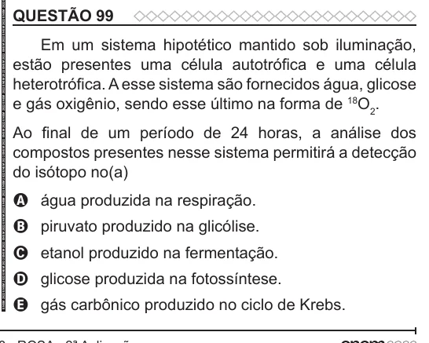

Texto extraído (pode conter ruído)

QUESTÃO 99  
Em um sistema hipotético mantido sob iluminação,  
estão presentes uma célula autotrófica e uma célula  
heterotrófica. A esse sistema são fornecidos água, glicose  
e gás oxigênio, sendo esse último na forma de 18 O 2 .  
Ao final de um período de 24 horas, a análise dos  
compostos presentes nesse sistema permitirá a detecção  
do isótopo no(a)  
A água produzida na respiração.  
B piruvato produzido na glicólise.  
C etanol produzido na fermentação.  
D glicose produzida na fotossíntese.  
E gás carbônico produzido no ciclo de Krebs.

