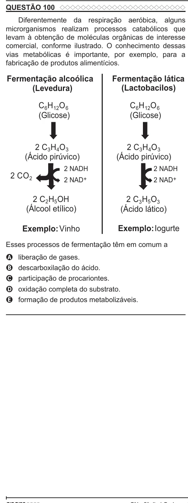

Texto extraído (pode conter ruído)

QUESTÃO 100  
Diferentemente da respiração aeróbica, alguns  
microrganismos realizam processos catabólicos que  
levam à obtenção de moléculas orgânicas de interesse  
comercial, conforme ilustrado. O conhecimento dessas  
vias metabólicas é importante, por exemplo, para a  
fabricação de produtos alimentícios.  
Fermentação alcoólica  
Fermentação lática  
(Levedura)  
(Lactobacilos)  
C 6 H 12 O 6  
C 6 H 12 O 6  
(Glicose)  
(Glicose)  
2 C 3 H 4 O 3  
2 C 3 H 4 O 3  
(Ácido pirúvico)  
(Ácido pirúvico)  
2 NADH  
2 NADH  
2 CO 2  
2 NAD +  
2 NAD +  
2 C 2 H 5 OH  
2 C 3 H 5 O 3  
(Álcool etílico)  
(Ácido lático)  
Exemplo: Vinho  
Exemplo:Iogurte  
Esses processos de fermentação têm em comum a  
liberação de gases.  
A  
descarboxilação do ácido.  
B  
participação de procariontes.  
C  
oxidação completa do substrato.  
D  
formação de produtos metabolizáveis.  
E

