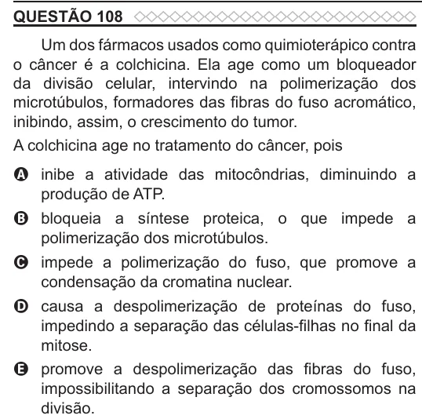

Texto extraído (pode conter ruído)

QUESTÃO 108  
Um dos fármacos usados como quimioterápico contra  
o câncer é a colchicina. Ela age como um bloqueador  
da divisão celular, intervindo na polimerização dos  
microtúbulos, formadores das fibras do fuso acromático,  
inibindo, assim, o crescimento do tumor.  
A colchicina age no tratamento do câncer, pois  
A inibe a atividade das mitocôndrias, diminuindo a  
produção de ATP.  
B bloqueia a síntese proteica, o que impede a  
polimerização dos microtúbulos.  
C impede a polimerização do fuso, que promove a  
condensação da cromatina nuclear.  
D causa a despolimerização de proteínas do fuso,  
impedindo a separação das células-filhas no final da  
mitose.  
E promove a despolimerização das fibras do fuso,  
impossibilitando a separação dos cromossomos na  
divisão.

