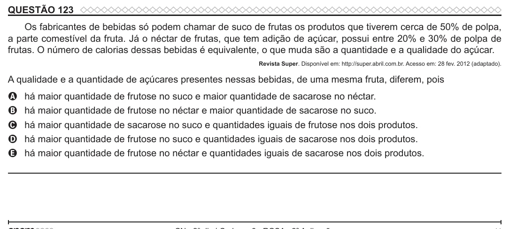

Texto extraído (pode conter ruído)

QUESTÃO 123  
Os fabricantes de bebidas só podem chamar de suco de frutas os produtos que tiverem cerca de 50% de polpa,  
a parte comestível da fruta. Já o néctar de frutas, que tem adição de açúcar, possui entre 20% e 30% de polpa de  
frutas. O número de calorias dessas bebidas é equivalente, o que muda são a quantidade e a qualidade do açúcar.  
Revista Super. Disponível em: http://super.abril.com.br. Acesso em: 28 fev. 2012 (adaptado).  
A qualidade e a quantidade de açúcares presentes nessas bebidas, de uma mesma fruta, diferem, pois  
há maior quantidade de frutose no suco e maior quantidade de sacarose no néctar.  
A  
há maior quantidade de frutose no néctar e maior quantidade de sacarose no suco.  
B  
há maior quantidade de sacarose no suco e quantidades iguais de frutose nos dois produtos.  
C  
há maior quantidade de frutose no suco e quantidades iguais de sacarose nos dois produtos.  
D  
E  
há maior quantidade de frutose no néctar e quantidades iguais de sacarose nos dois produtos.

