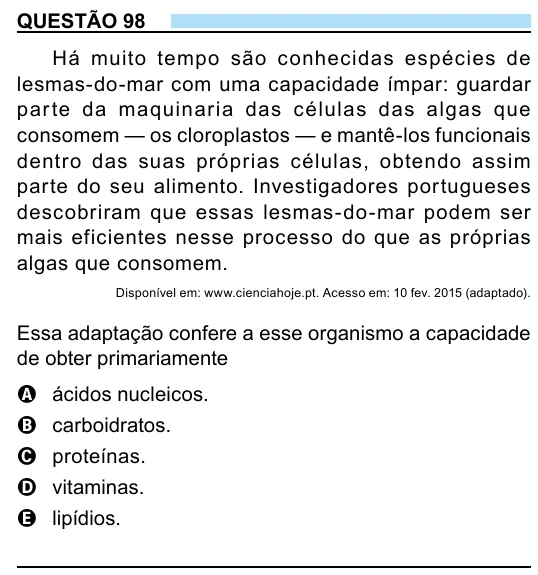

Texto extraído (pode conter ruído)

QUESTÃO 98  
Há muito tempo são conhecidas espécies de  
lesmas-do-mar com uma capacidade ímpar: guardar  
par te da maquinaria das células das algas que  
consomem — os cloroplastos — e mantê-los funcionais  
dentro das suas próprias células, obtendo assim  
parte do seu alimento. Investigadores portugueses  
descobriram que essas lesmas-do-mar podem ser  
mais eficientes nesse processo do que as próprias  
algas que consomem.  
Disponível em: www.cienciahoje.pt. Acesso em: 10 fev. 2015 (adaptado).  
Essa adaptação confere a esse organismo a capacidade  
de obter primariamente  
A ácidos nucleicos.  
B carboidratos.  
C proteínas.  
D vitaminas.  
E lipídios.

