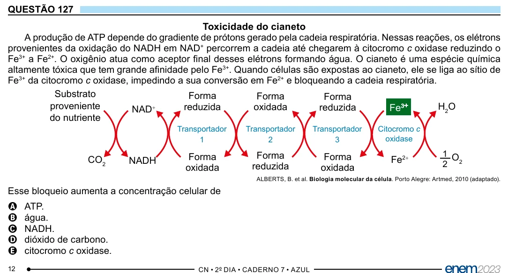

Texto extraído (pode conter ruído)

QUESTÃO 127  
Toxicidade do cianeto  
A produção de ATP depende do gradiente de prótons gerado pela cadeia respiratória. Nessas reações, os elétrons  
provenientes da oxidação do NADH em NAD + percorrem a cadeia até chegarem à citocromo c oxidase reduzindo o  
Fe 3+ a Fe 2+ . O oxigênio atua como aceptor final desses elétrons formando água. O cianeto é uma espécie química  
altamente tóxica que tem grande afinidade pelo Fe 3+ . Quando células são expostas ao cianeto, ele se liga ao sítio de  
Fe 3+ da citocromo c oxidase, impedindo a sua conversão em Fe 2+ e bloqueando a cadeia respiratória.  
Substrato  
Forma  
Forma  
Forma  
proveniente  
H 2 O  
NAD  
reduzida  
oxidada  
reduzida  
Fe 3 +  
+  
do nutriente  
Transportador  
Transportador  
Transportador  
Citocromo c  
1  
2  
3  
oxidase  
Forma  
1 O  
Forma  
Forma  
CO 2  
NADH  
Fe 2+  
2 2  
oxidada  
reduzida  
oxidada  
ALBERTS, B. et al. Biologia molecular da célula. Porto Alegre: Artmed, 2010 (adaptado).  
Esse bloqueio aumenta a concentração celular de  
ATP.  
A  
B  
água.  
NADH.  
C  
dióxido de carbono.  
D  
citocromo c oxidase.  
E  
12

