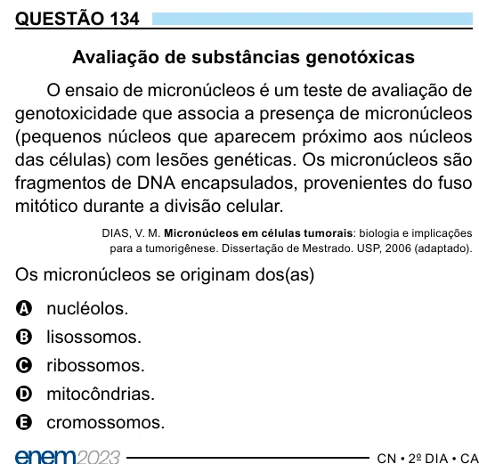

Texto extraído (pode conter ruído)

QUESTÃO 134  
Avaliação de substâncias genotóxicas  
O ensaio de micronúcleos é um teste de avaliação de  
genotoxicidade que associa a presença de micronúcleos  
(pequenos núcleos que aparecem próximo aos núcleos  
das células) com lesões genéticas. Os micronúcleos são  
fragmentos de DNA encapsulados, provenientes do fuso  
mitótico durante a divisão celular.  
DIAS, V. M. Micronúcleos em células tumorais: biologia e implicações  
para a tumorigênese. Dissertação de Mestrado. USP, 2006 (adaptado).  
Os micronúcleos se originam dos(as)  
A nucléolos.  
B lisossomos.  
C ribossomos.  
D mitocôndrias.  
E cromossomos.

