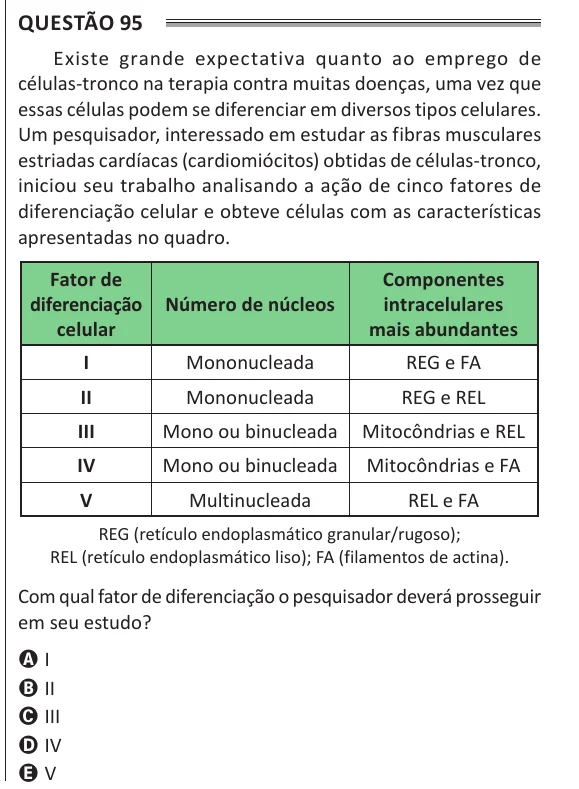

Texto extraído (pode conter ruído)

Questão 95  
Existe grande expectativa quanto ao emprego de  
células-tronco na terapia contra muitas doenças, uma vez que  
essas células podem se diferenciar em diversos tipos celulares.  
Um pesquisador, interessado em estudar as fibras musculares  
estriadas cardíacas (cardiomiócitos) obtidas de células-tronco,  
iniciou seu trabalho analisando a ação de cinco fatores de  
diferenciação celular e obteve células com as características  
apresentadas no quadro.  
Fator de  
Componentes  
diferenciação  
Número de núcleos  
intracelulares  
celular  
mais abundantes  
I  
Mononucleada  
REG e FA  
II  
Mononucleada  
REG e REL  
III  
Mono ou binucleada  
Mitocôndrias e REL  
IV  
Mono ou binucleada  
Mitocôndrias e FA  
V  
Multinucleada  
REL e FA  
REG (retículo endoplasmático granular/rugoso);  
REL (retículo endoplasmático liso); FA (filamentos de actina).  
Com qual fator de diferenciação o pesquisador deverá prosseguir  
em seu estudo?  
A I  
B II  
C III  
D IV  
E V

