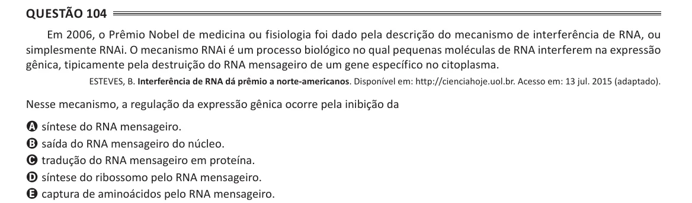

Texto extraído (pode conter ruído)

Questão 104  
Em 2006, o Prêmio Nobel de medicina ou fisiologia foi dado pela descrição do mecanismo de interferência de RNA, ou  
simplesmente RNAi. O mecanismo RNAi é um processo biológico no qual pequenas moléculas de RNA interferem na expressão  
gênica, tipicamente pela destruição do RNA mensageiro de um gene específico no citoplasma.  
ESTEVES, B. Interferência de RNA dá prêmio a norte-americanos. Disponível em: http://cienciahoje.uol.br. Acesso em: 13 jul. 2015 (adaptado).  
Nesse mecanismo, a regulação da expressão gênica ocorre pela inibição da  
A síntese do RNA mensageiro.  
B saída do RNA mensageiro do núcleo.  
C tradução do RNA mensageiro em proteína.  
D síntese do ribossomo pelo RNA mensageiro.  
E captura de aminoácidos pelo RNA mensageiro.

