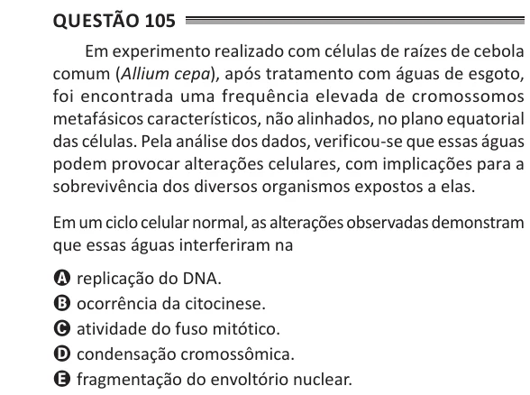

Texto extraído (pode conter ruído)

Questão 105  
Em experimento realizado com células de raízes de cebola  
comum (Allium cepa), após tratamento com águas de esgoto,  
foi encontrada uma frequência elevada de cromossomos  
metafásicos característicos, não alinhados, no plano equatorial  
das células. Pela análise dos dados, verificou-se que essas águas  
podem provocar alterações celulares, com implicações para a  
sobrevivência dos diversos organismos expostos a elas.  
Em um ciclo celular normal, as alterações observadas demonstram  
que essas águas interferiram na  
A replicação do DNA.  
B ocorrência da citocinese.  
C atividade do fuso mitótico.  
D condensação cromossômica.  
E fragmentação do envoltório nuclear.

