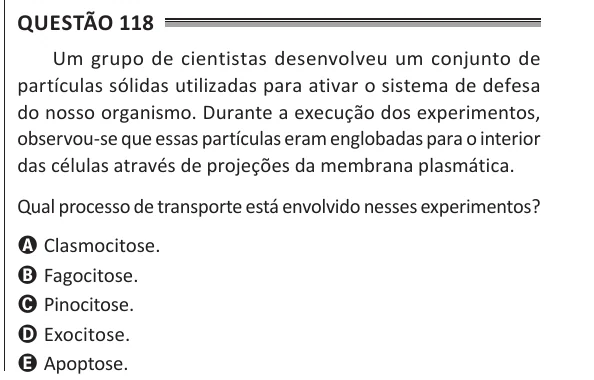

Texto extraído (pode conter ruído)

Questão 118  
Um grupo de cientistas desenvolveu um conjunto de  
partículas sólidas utilizadas para ativar o sistema de defesa  
do nosso organismo. Durante a execução dos experimentos,  
observou-se que essas partículas eram englobadas para o interior  
das células através de projeções da membrana plasmática.  
Qual processo de transporte está envolvido nesses experimentos?  
A Clasmocitose.  
B Fagocitose.  
C Pinocitose.  
D Exocitose.  
E Apoptose.

