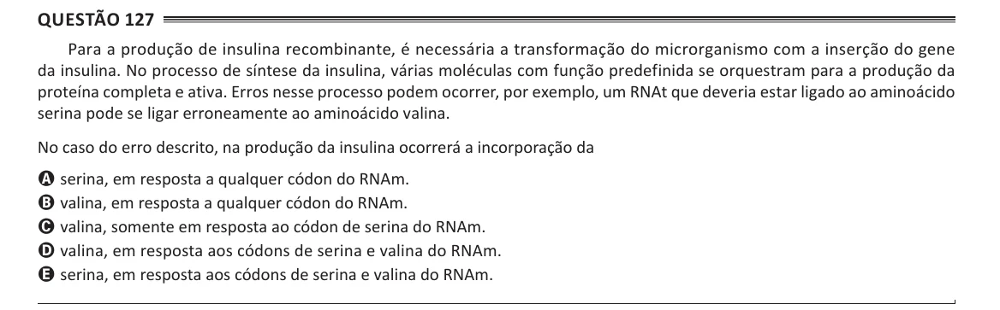

Texto extraído (pode conter ruído)

Questão 127  
Para a produção de insulina recombinante, é necessária a transformação do microrganismo com a inserção do gene  
da insulina. No processo de síntese da insulina, várias moléculas com função predefinida se orquestram para a produção da  
proteína completa e ativa. Erros nesse processo podem ocorrer, por exemplo, um RNAt que deveria estar ligado ao aminoácido  
serina pode se ligar erroneamente ao aminoácido valina.  
No caso do erro descrito, na produção da insulina ocorrerá a incorporação da  
A serina, em resposta a qualquer códon do RNAm.  
B valina, em resposta a qualquer códon do RNAm.  
C valina, somente em resposta ao códon de serina do RNAm.  
D valina, em resposta aos códons de serina e valina do RNAm.  
E serina, em resposta aos códons de serina e valina do RNAm.

