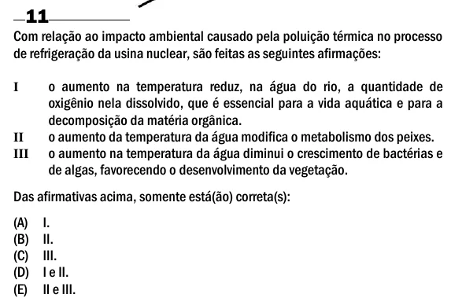

Texto extraído (pode conter ruído)

11  
Com relação ao impacto ambiental causado pela poluição térmica no processo  
de refrigeração da usina nuclear, são feitas as seguintes afirmações:  
o aumento na temperatura reduz, na água do rio, a quantidade de  
I  
oxigênio nela dissolvido, que é essencial para a vida aquática e para a  
decomposição da matéria orgânica.  
o aumento da temperatura da água modifica o metabolismo dos peixes.  
II  
o aumento na temperatura da água diminui o crescimento de bactérias e  
III  
de algas, favorecendo o desenvolvimento da vegetação.  
Das afirmativas acima, somente está(ão) correta(s):  
(A)  
I.  
(B)  
II.  
(C)  
III.  
(D)  
I e II.  
(E)  
II e III.

