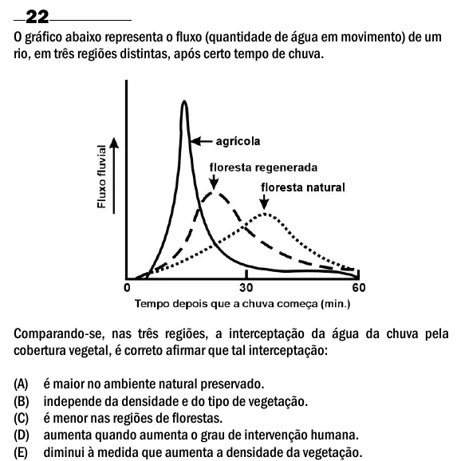

Texto extraído (pode conter ruído)

22  
O gráfico abaixo representa o fluxo (quantidade de água em movimento) de um  
rio, em três regiões distintas, após certo tempo de chuva.  
Comparando-se, nas três regiões, a interceptação da água da chuva pela  
cobertura vegetal, é correto afirmar que tal interceptação:  
(A)  
é maior no ambiente natural preservado.  
(B)  
independe da densidade e do tipo de vegetação.  
(C)  
é menor nas regiões de florestas.  
(D)  
aumenta quando aumenta o grau de intervenção humana.  
(E)  
diminui à medida que aumenta a densidade da vegetação.

