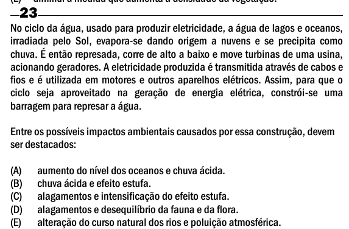

Texto extraído (pode conter ruído)

23  
No ciclo da água, usado para produzir eletricidade, a água de lagos e oceanos,  
irradiada pelo Sol, evapora-se dando origem a nuvens e se precipita como  
chuva. É então represada, corre de alto a baixo e move turbinas de uma usina,  
acionando geradores. A eletricidade produzida é transmitida através de cabos e  
fios e é utilizada em motores e outros aparelhos elétricos. Assim, para que o  
ciclo seja aproveitado na geração de energia elétrica, constrói-se uma  
barragem para represar a água.  
Entre os possíveis impactos ambientais causados por essa construção, devem  
ser destacados:  
(A)  
aumento do nível dos oceanos e chuva ácida.  
(B)  
chuva ácida e efeito estufa.  
(C)  
alagamentos e intensificação do efeito estufa.  
(D)  
alagamentos e desequilíbrio da fauna e da flora.  
(E)  
alteração do curso natural dos rios e poluição atmosférica.

