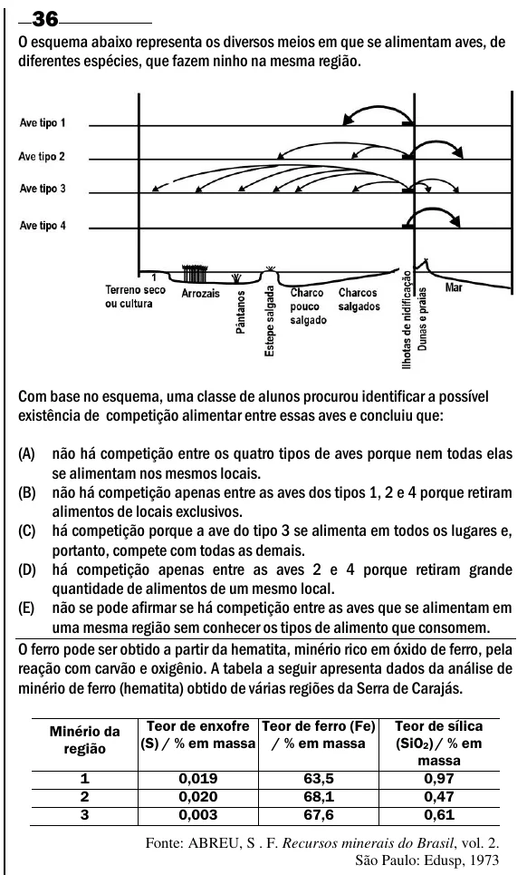

Texto extraído (pode conter ruído)

36  
O esquema abaixo representa os diversos meios em que se alimentam aves, de  
diferentes espécies, que fazem ninho na mesma região.  
Com base no esquema, uma classe de alunos procurou identificar a possível  
existência de competição alimentar entre essas aves e concluiu que:  
(A)  
não há competição entre os quatro tipos de aves porque nem todas elas  
se alimentam nos mesmos locais.  
(B) não há competição apenas entre as aves dos tipos 1, 2 e 4 porque retiram  
alimentos de locais exclusivos.  
(C) há competição porque a ave do tipo 3 se alimenta em todos os lugares e,  
portanto, compete com todas as demais.  
(D) há competição apenas entre as aves 2 e 4 porque retiram grande  
quantidade de alimentos de um mesmo local.  
(E) não se pode afirmar se há competição entre as aves que se alimentam em  
uma mesma região sem conhecer os tipos de alimento que consomem.  
O ferro pode ser obtido a partir da hematita, minério rico em óxido de ferro, pela  
reação com carvão e oxigênio. A tabela a seguir apresenta dados da análise de  
minério de ferro (hematita) obtido de várias regiões da Serra de Carajás.  
Teor de enxofre Teor de ferro (Fe)  
Teor de sílica  
Minério da  
(S) / % em massa / % em massa  
(SiO 2 ) / % em  
região  
massa  
1  
0,019  
63,5  
0,97  
2  
0,020  
68,1  
0,47  
3  
0,003  
67,6  
0,61  
Fonte: ABREU, S . F. Recursos minerais do Brasil, vol. 2.  
São Paulo: Edusp, 1973

