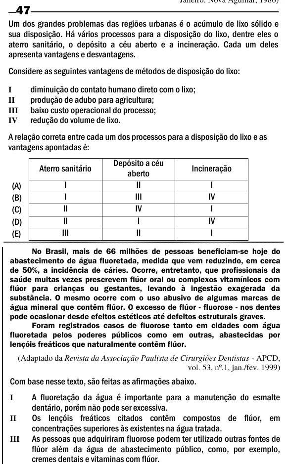

Texto extraído (pode conter ruído)

47  
Um dos grandes problemas das regiões urbanas é o acúmulo de lixo sólido e  
sua disposição. Há vários processos para a disposição do lixo, dentre eles o  
aterro sanitário, o depósito a céu aberto e a incineração. Cada um deles  
apresenta vantagens e desvantagens.  
Considere as seguintes vantagens de métodos de disposição do lixo:  
diminuição do contato humano direto com o lixo;  
I  
produção de adubo para agricultura;  
II  
baixo custo operacional do processo;  
III  
redução do volume de lixo.  
IV  
A relação correta entre cada um dos processos para a disposição do lixo e as  
vantagens apontadas é:  
Depósito a céu  
Aterro sanitário  
Incineração  
aberto  
I  
II  
I  
(A)  
I  
III  
IV  
(B)  
II  
IV  
I  
(C)  
(D)  
II  
I  
IV  
(E)  
III  
II  
I  
No Brasil, mais de 66 milhões de pessoas beneficiam-se hoje do  
abastecimento de água fluoretada, medida que vem reduzindo, em cerca  
de 50%, a incidência de cáries. Ocorre, entretanto, que profissionais da  
saúde muitas vezes prescrevem flúor oral ou complexos vitamínicos com  
flúor para crianças ou gestantes, levando à ingestão exagerada da  
substância. O mesmo ocorre com o uso abusivo de algumas marcas de  
água mineral que contêm flúor. O excesso de flúor - fluorose - nos dentes  
pode ocasionar desde efeitos estéticos até defeitos estruturais graves.  
Foram registrados casos de fluorose tanto em cidades com água  
fluoretada pelos poderes públicos como em outras, abastecidas por  
lençóis freáticos que naturalmente contêm flúor.  
(Adaptado da Revista da Associação Paulista de Cirurgiões Dentistas - APCD,  
vol. 53, nº.1, jan./fev. 1999)  
Com base nesse texto, são feitas as afirmações abaixo.  
I  
A fluoretação da água é importante para a manutenção do esmalte  
dentário, porém não pode ser excessiva.  
Os lençóis freáticos citados contêm compostos de flúor, em  
II  
concentrações superiores às existentes na água tratada.  
As pessoas que adquiriram fluorose podem ter utilizado outras fontes de  
III  
flúor além da água de abastecimento público, como, por exemplo,  
cremes dentais e vitaminas com flúor.

