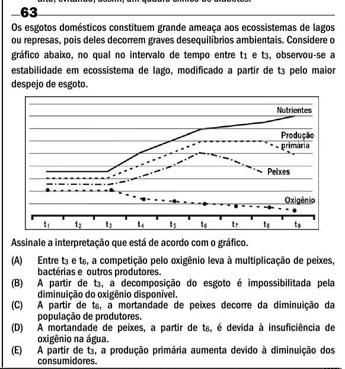

Texto extraído (pode conter ruído)

63  
Os esgotos domésticos constituem grande ameaça aos ecossistemas de lagos  
ou represas, pois deles decorrem graves desequilíbrios ambientais. Considere o  
gráfico abaixo, no qual no intervalo de tempo entre t 1 e t 3 , observou-se a  
estabilidade em ecossistema de lago, modificado a partir de t 3 pelo maior  
despejo de esgoto.  
Assinale a interpretação que está de acordo com o gráfico.  
(A)  
Entre t 3 e t 6 , a competição pelo oxigênio leva à multiplicação de peixes,  
bactérias e outros produtores.  
(B)  
A partir de t 3 , a decomposição do esgoto é impossibilitada pela  
diminuição do oxigênio disponível.  
(C)  
A partir de t 6 , a mortandade de peixes decorre da diminuição da  
população de produtores.  
(D)  
A mortandade de peixes, a partir de t 6 , é devida à insuficiência de  
oxigênio na água.  
(E)  
A partir de t 3 , a produção primária aumenta devido à diminuição dos  
consumidores.

