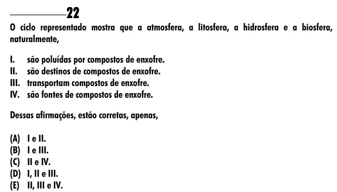

Texto extraído (pode conter ruído)

22  
O ciclo representado mostra que a atmosfera, a litosfera, a hidrosfera e a biosfera,  
naturalmente,  
I.  
são poluídas por compostos de enxofre.  
II.  
são destinos de compostos de enxofre.  
III.  
transportam compostos de enxofre.  
IV.  
são fontes de compostos de enxofre.  
Dessas afirmações, estão corretas, apenas,  
(A) I e II.  
(B) I e III.  
(C) II e IV.  
(D) I, II e III.  
(E) II, III e IV.

