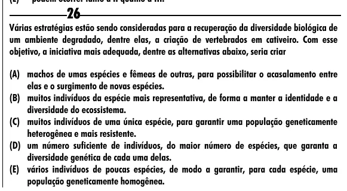

Texto extraído (pode conter ruído)

26  
Várias estratégias estão sendo consideradas para a recuperação da diversidade biológica de  
um ambiente degradado, dentre elas, a criação de vertebrados em cativeiro. Com esse  
objetivo, a iniciativa mais adequada, dentre as alternativas abaixo, seria criar  
(A) machos de umas espécies e fêmeas de outras, para possibilitar o acasalamento entre  
elas e o surgimento de novas espécies.  
(B) muitos indivíduos da espécie mais representativa, de forma a manter a identidade e a  
diversidade do ecossistema.  
(C) muitos indivíduos de uma única espécie, para garantir uma população geneticamente  
heterogênea e mais resistente.  
(D) um número suficiente de indivíduos, do maior número de espécies, que garanta a  
diversidade genética de cada uma delas.  
(E) vários indivíduos de poucas espécies, de modo a garantir, para cada espécie, uma  
população geneticamente homogênea.

