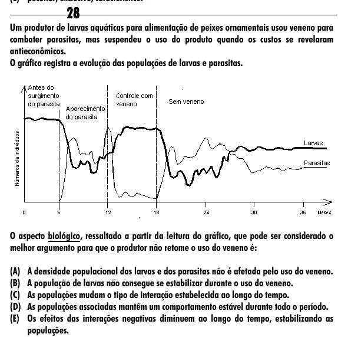

Texto extraído (pode conter ruído)

28  
Um produtor de larvas aquáticas para alimentação de peixes ornamentais usou veneno para  
combater parasitas, mas suspendeu o uso do produto quando os custos se revelaram  
antieconômicos.  
O gráfico registra a evolução das populações de larvas e parasitas.  
O aspecto biológico, ressaltado a partir da leitura do gráfico, que pode ser considerado o  
melhor argumento para que o produtor não retome o uso do veneno é:  
(A) A densidade populacional das larvas e dos parasitas não é afetada pelo uso do veneno.  
(B) A população de larvas não consegue se estabilizar durante o uso do veneno.  
(C) As populações mudam o tipo de interação estabelecida ao longo do tempo.  
(D) As populações associadas mantêm um comportamento estável durante todo o período.  
(E) Os efeitos das interações negativas diminuem ao longo do tempo, estabilizando as  
populações.

