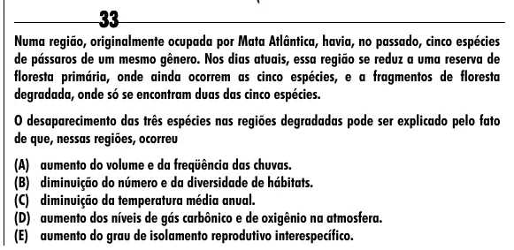

Texto extraído (pode conter ruído)

33  
Numa região, originalmente ocupada por Mata Atlântica, havia, no passado, cinco espécies  
de pássaros de um mesmo gênero. Nos dias atuais, essa região se reduz a uma reserva de  
floresta primária, onde ainda ocorrem as cinco espécies, e a fragmentos de floresta  
degradada, onde só se encontram duas das cinco espécies.  
O desaparecimento das três espécies nas regiões degradadas pode ser explicado pelo fato  
de que, nessas regiões, ocorreu  
(A) aumento do volume e da freqüência das chuvas.  
(B) diminuição do número e da diversidade de hábitats.  
(C) diminuição da temperatura média anual.  
(D) aumento dos níveis de gás carbônico e de oxigênio na atmosfera.  
(E) aumento do grau de isolamento reprodutivo interespecífico.

