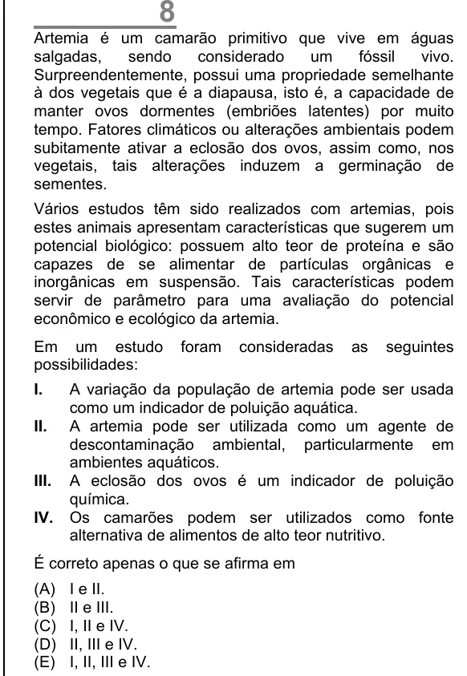

Texto extraído (pode conter ruído)

Artemia é um camarão primitivo que vive em águas  
salgadas,  
sendo  
considerado  
um  
fóssil  
vivo.  
Surpreendentemente, possui uma propriedade semelhante  
à dos vegetais que é a diapausa, isto é, a capacidade de  
manter ovos dormentes (embriões latentes) por muito  
tempo. Fatores climáticos ou alterações ambientais podem  
subitamente ativar a eclosão dos ovos, assim como, nos  
vegetais, tais alterações induzem a germinação de  
sementes.  
Vários estudos têm sido realizados com artemias, pois  
estes animais apresentam características que sugerem um  
potencial biológico: possuem alto teor de proteína e são  
capazes de se alimentar de partículas orgânicas e  
inorgânicas em suspensão. Tais características podem  
servir de parâmetro para uma avaliação do potencial  
econômico e ecológico da artemia.  
Em um estudo  
foram  
consideradas  
as  
seguintes  
possibilidades:  
I.  
A variação da população de artemia pode ser usada  
como um indicador de poluição aquática.  
II.  
A artemia pode ser utilizada como um agente de  
descontaminação ambiental, particularmente em  
ambientes aquáticos.  
III.  
A eclosão dos ovos é um indicador de poluição  
química.  
IV.  
Os camarões podem ser utilizados como fonte  
alternativa de alimentos de alto teor nutritivo.  
É correto apenas o que se afirma em  
(A)  
I e II.  
(B)  
II e III.  
(C)  
I, II e IV.  
(D)  
II, III e IV.  
(E)  
I, II, III e IV.

