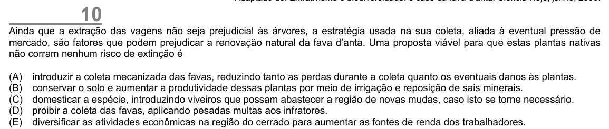

Texto extraído (pode conter ruído)

10  
Ainda que a extração das vagens não seja prejudicial às árvores, a estratégia usada na sua coleta, aliada à eventual pressão de  
mercado, são fatores que podem prejudicar a renovação natural da fava d’anta. Uma proposta viável para que estas plantas nativas  
não corram nenhum risco de extinção é  
(A)  
introduzir a coleta mecanizada das favas, reduzindo tanto as perdas durante a coleta quanto os eventuais danos às plantas.  
(B)  
conservar o solo e aumentar a produtividade dessas plantas por meio de irrigação e reposição de sais minerais.  
(C)  
domesticar a espécie, introduzindo viveiros que possam abastecer a região de novas mudas, caso isto se torne necessário.  
(D)  
proibir a coleta das favas, aplicando pesadas multas aos infratores.  
(E)  
diversificar as atividades econômicas na região do cerrado para aumentar as fontes de renda dos trabalhadores.

