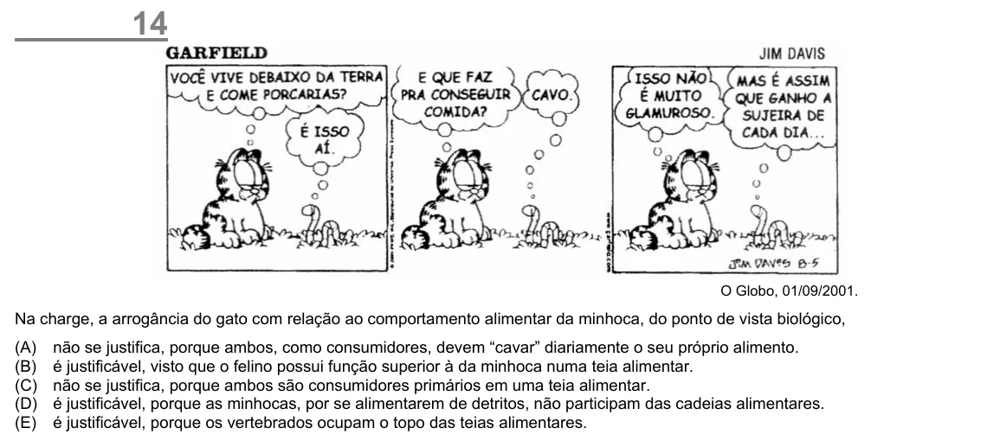

Texto extraído (pode conter ruído)

14  
O Globo, 01/09/2001.  
Na charge, a arrogância do gato com relação ao comportamento alimentar da minhoca, do ponto de vista biológico,  
(A)  
não se justifica, porque ambos, como consumidores, devem “cavar” diariamente o seu próprio alimento.  
(B)  
é justificável, visto que o felino possui função superior à da minhoca numa teia alimentar.  
(C)  
não se justifica, porque ambos são consumidores primários em uma teia alimentar.  
(D)  
é justificável, porque as minhocas, por se alimentarem de detritos, não participam das cadeias alimentares.  
(E)  
é justificável, porque os vertebrados ocupam o topo das teias alimentares.

