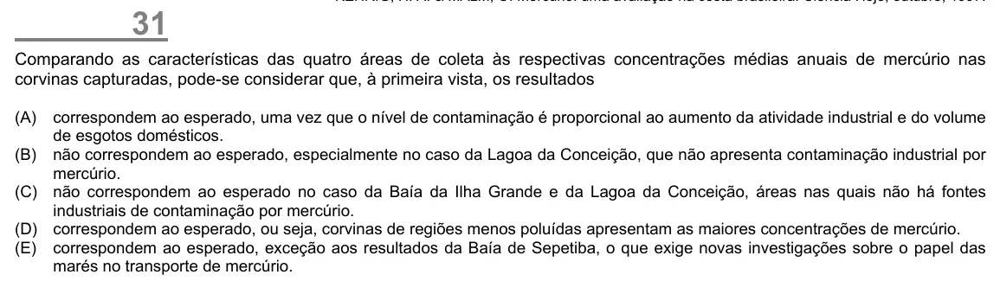

Texto extraído (pode conter ruído)

31  
Comparando as características das quatro áreas de coleta às respectivas concentrações médias anuais de mercúrio nas  
corvinas capturadas, pode-se considerar que, à primeira vista, os resultados  
(A)  
correspondem ao esperado, uma vez que o nível de contaminação é proporcional ao aumento da atividade industrial e do volume  
de esgotos domésticos.  
(B) não correspondem ao esperado, especialmente no caso da Lagoa da Conceição, que não apresenta contaminação industrial por  
mercúrio.  
(C) não correspondem ao esperado no caso da Baía da Ilha Grande e da Lagoa da Conceição, áreas nas quais não há fontes  
industriais de contaminação por mercúrio.  
(D) correspondem ao esperado, ou seja, corvinas de regiões menos poluídas apresentam as maiores concentrações de mercúrio.  
(E) correspondem ao esperado, exceção aos resultados da Baía de Sepetiba, o que exige novas investigações sobre o papel das  
marés no transporte de mercúrio.

