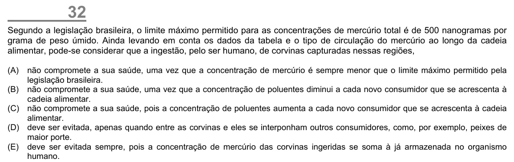

Texto extraído (pode conter ruído)

32  
Segundo a legislação brasileira, o limite máximo permitido para as concentrações de mercúrio total é de 500 nanogramas por  
grama de peso úmido. Ainda levando em conta os dados da tabela e o tipo de circulação do mercúrio ao longo da cadeia  
alimentar, pode-se considerar que a ingestão, pelo ser humano, de corvinas capturadas nessas regiões,  
(A)  
não compromete a sua saúde, uma vez que a concentração de mercúrio é sempre menor que o limite máximo permitido pela  
legislação brasileira.  
(B) não compromete a sua saúde, uma vez que a concentração de poluentes diminui a cada novo consumidor que se acrescenta à  
cadeia alimentar.  
(C) não compromete a sua saúde, pois a concentração de poluentes aumenta a cada novo consumidor que se acrescenta à cadeia  
alimentar.  
(D) deve ser evitada, apenas quando entre as corvinas e eles se interponham outros consumidores, como, por exemplo, peixes de  
maior porte.  
(E) deve ser evitada sempre, pois a concentração de mercúrio das corvinas ingeridas se soma à já armazenada no organismo  
humano.

